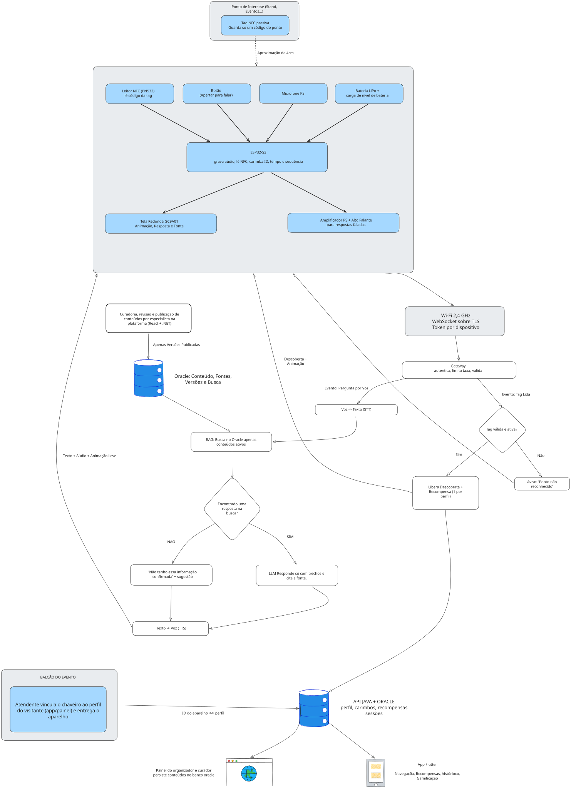

# Chaveiro-Passaporte de Descobertas

**Proposta de IoT e Redes para a plataforma de aprendizado sobre tecnologia nuclear (Challenge AMAZUL).**

FIAP · Análise e Desenvolvimento de Sistemas · Disruptive Architectures: IoT, IoB & Generative IA · Entrega do 1º Sprint

## Links principais

| Item | Link |
|---|---|
| **Vídeo pitch (YouTube, não listado)** | https://youtu.be/G2_cnfmsUZI |
| **Design System (fluxograma do sistema)** | [`design-system/design-system-chaveiro-passaporte.svg`](design-system/design-system-chaveiro-passaporte.svg) |
| **Fluxograma interativo (Excalidraw)** | [abrir no Excalidraw](https://excalidraw.com/#json=2TulqWKhCVXWzyDQ_-Kv0,DDHy8RHHJvTlpH9j04l5Hw) |
| **Documento completo (PDF, padrão ABNT)** | [`docs/proposta-chaveiro-passaporte-S1.pdf`](docs/proposta-chaveiro-passaporte-S1.pdf) |

## Grupo

| Integrante | RM |
|---|---|
| Paulo Cavalcante Caroba | 566667 |
| Renan da Silva Paulino | 566610 |
| Sérgio Henrique da Silva Santos | 567254 |

**Orientador:** Marcel Stefan Wagner · **Turma:** 2TDS

> **Importante:** este é um trabalho acadêmico e **conceitual**. Nada foi construído ou medido ainda: desempenho, custo e ganho de aprendizado são hipóteses a validar. O projeto não representa a AMAZUL, a Marinha ou qualquer outra instituição, e não afirma parceria, patrocínio ou aprovação de ninguém.

---

## 1. O problema

Muita gente conhece pouco as aplicações da tecnologia nuclear e costuma ligá-la só a usinas, radiação e uso militar.

A plataforma do Challenge AMAZUL ajuda com **histórias curtas, revisadas por especialistas, em linguagem simples**. Mas um aplicativo sozinho deixa dois buracos:

1.  **O conteúdo fica preso ao celular**, longe dos lugares e eventos onde a pessoa realmente vê o assunto.
2.  **Quem tem dúvida pode não ter a quem perguntar**, e a internet mistura fato e desinformação.

## 2. A nossa ideia

Um **chaveiro que funciona como passaporte**. Ele tem tela redonda, botão, microfone, alto-falante e um leitor de aproximação (NFC).

Num evento de ciência, por exemplo:

| Passo | O que acontece |
|---|---|
| **Pegar** | O visitante cria o perfil no aplicativo e recebe o chaveiro no balcão. O atendente vincula o aparelho ao perfil. |
| **Descobrir** | Ele encosta o chaveiro numa **tag NFC** (um adesivo sem bateria) atrás de um cartaz. A tela mostra uma animação, o chaveiro conta uma história curta e o aplicativo ganha um **card colecionável** e outras recompensas. |
| **Perguntar** | Ele aperta o botão e pergunta por voz. A resposta vem **só de conteúdo revisado** e mostra a fonte. Se não houver base, o chaveiro diz: *"Não tenho essa informação confirmada."* |
| **Treinar** | Responde a uma pergunta de compreensão com o botão (toque curto = A, toque longo = B) e ganha recompensa. |
| **Devolver** | O vínculo é apagado. Os prêmios ficam no perfil da pessoa. |

> O aprendizado continua no aplicativo. O chaveiro é a parte que **leva o conteúdo para o mundo real**.

### Entrega em camadas (para reduzir risco)

Cada camada funciona mesmo que a seguinte não fique pronta.

| Camada | O que entrega | Funciona sem internet? |
|---|---|---|
| 0 | Encostar na tag libera a descoberta e o card | Sim (guarda os eventos e envia depois) |
| 1 | História curta em áudio gravado | Sim |
| 2 | Perguntas respondidas pela base de conteúdo revisado | Não |
| 3 | Respostas redigidas por IA, usando só os trechos revisados e citando a fonte | Não |
| 4 | Quiz do aplicativo feito no próprio chaveiro | Sim (guarda os eventos e envia depois) |

---

## 3. Design System: o desenho do sistema

A pasta [`design-system/`](design-system/) guarda o **fluxograma do sistema** (o "mapa" de como tudo se conecta). Abaixo está a imagem em SVG. Para ver os detalhes, abra o arquivo ou o [link no Excalidraw](https://excalidraw.com/#json=2TulqWKhCVXWzyDQ_-Kv0,DDHy8RHHJvTlpH9j04l5Hw).

<p align="center">
  <a href="design-system/design-system-chaveiro-passaporte.svg">
    
  </a>
</p>

### Como ler o fluxograma

O desenho segue o caminho de uma pessoa usando o chaveiro:

1. **Balcão do evento:** o atendente liga o ID do chaveiro ao perfil do visitante.
2. **Ponto de interesse:** uma tag NFC guarda só um código. O leitor do chaveiro lê esse código a cerca de 4 cm.
3. **Chaveiro (ESP32-S3):** é o "cérebro". Lê a tag, grava a voz, mostra animações na tela e toca o áudio.
4. **Wi-Fi seguro:** o chaveiro conversa com o servidor por Wi-Fi 2,4 GHz, com conexão protegida (TLS) e uma senha própria de cada aparelho (token).
5. **Gateway:** é a "portaria" do servidor. Confere quem está falando, limita abusos e valida os dados.
6. **Dois caminhos a partir daí:**
   - **Tag lida:** o sistema confere se o ponto existe e está ativo. Se sim, libera a descoberta e a recompensa (uma por perfil e ponto). Se não, mostra *"Ponto não reconhecido"*.
   - **Pergunta por voz:** a voz vira texto → o sistema procura a resposta no banco → se achou, a IA escreve a resposta usando só aqueles trechos e cita a fonte → o texto vira voz e volta ao chaveiro. Se não achou, responde *"Não tenho essa informação confirmada"*.
7. **Banco de dados (Oracle) e API Java:** guardam perfis, carimbos, recompensas e conteúdo.
8. **Quem usa os dados:** o **aplicativo Flutter** (visitante vê cards e recompensas) e o **painel de curadoria e organização** (React + .NET).

---

## 4. Tecnologias e componentes

### O chaveiro (hardware)

| Componente | Para que serve |
|---|---|
| **ESP32-S3** (placa DevKitC-1 N32R16V) | Cérebro: controla tela, áudio, botão e NFC e conecta ao Wi-Fi |
| **Tela redonda GC9A01** (1,28") | Mostra animação, resposta e fonte |
| **Microfone digital I²S** | Escuta a voz (só com o botão apertado) |
| **Botão** | Falar com o chaveiro (push-to-talk) e responder ao quiz |
| **Leitor NFC PN532** (ou RC522) | Lê o código das tags |
| **Amplificador MAX98357A + alto-falante** | Fala as respostas |
| **Bateria LiPo com carga e proteção** | Uso sem cabo |
| **Tags NFC passivas (NTAG)** | Marcam os pontos do evento; sem bateria e sem internet |

### O servidor e os aplicativos (software)

| Peça | Para que serve |
|---|---|
| **Gateway** | Porta de entrada: autentica e protege |
| **STT** (voz → texto) e **TTS** (texto → voz) | Transformam a fala em texto e o texto em fala |
| **RAG sobre Oracle** | Busca a resposta só no conteúdo publicado e ativo |
| **LLM** (IA generativa) | Escreve a resposta com os trechos encontrados e cita a fonte |
| **API Java + Oracle** | Guarda perfis, carimbos, cards, recompensas e sessões |
| **App Flutter** | Coleção, histórico e vínculo do chaveiro |
| **Painel web (React + .NET)** | Curadoria do conteúdo e visão do organizador |

> A inteligência artificial **não roda no chaveiro**. Ele captura, mostra e toca; o trabalho pesado fica no servidor.

---

## 5. Como os aparelhos se comunicam

| Trecho | Como | Por quê |
|---|---|---|
| Tag ↔ chaveiro | **NFC**, a poucos centímetros | Simples e sem bateria na tag |
| Chaveiro ↔ servidor | **Wi-Fi 2,4 GHz** com WebSocket sobre TLS e token por aparelho | Áudio e respostas nos dois sentidos, de forma segura |
| Configurar o Wi-Fi | **Bluetooth (BLE)** pelo aplicativo | Trocar de rede sem recompilar |
| Entre os serviços | **HTTPS/REST** | Padrão simples |
| Sem Wi-Fi | Aviso na tela; eventos guardados e enviados depois | Honestidade: nada é inventado |

**Por que não outras opções?** MQTT é ótimo para sensores, mas aqui o foco é áudio em fluxo. Bluetooth tem alcance e taxa limitados para áudio. 4G custa mais, gasta mais energia e aumenta o tamanho. QR code exige câmera e é menos imediato que encostar.

## 6. Caminho dos dados (resumo)

**Vínculo** → **leitura da tag** → **voz em pedaços curtos** → **transcrição** → **busca no Oracle** (só conteúdo publicado e ativo) → **IA responde com fonte** → **voz de volta ao chaveiro** → **progresso registrado** → **dados agregados** para curador e organizador.

Dados coletados: código da tag, voz (só com o botão apertado), eventos do botão, nível de bateria, qualidade do Wi-Fi e resultados do quiz. O organizador recebe **somente dados agregados e anônimos** (ex.: visitas por ponto).

## 7. Benefícios

- Leva o conteúdo revisado a lugares e eventos reais, de forma casual.
- Reduz desinformação: só responde com conteúdo revisado e mostra a fonte.
- Dá ao **curador** a lista de perguntas sem resposta e ao **organizador** os pontos mais visitados.
- Abre caminho para sustentabilidade financeira (por exemplo, locação em eventos), **a validar**.

## 8. Limitações

- O aprendizado em si acontece no aplicativo; o ganho de compreensão pelo chaveiro é uma hipótese.
- As camadas 2 e 3 precisam de Wi-Fi no local e de alguém para instalar as tags e cuidar do balcão.
- A qualidade depende de voz e áudio em português e do barulho do ambiente.
- A tag NFC pode ser copiada: o carimbo é uma experiência, **não uma prova de presença**.
- A revisão humana do conteúdo continua necessária.
- Latência, custo por pergunta, bateria, som e mapa de pinos ainda dependem de protótipo.
- Com tela, leitor NFC, microfone e amplificador, o protótipo pode ficar **maior que um chaveiro de bolso**.

## 9. Privacidade e escopo

- O microfone só capta com o botão apertado (garantido pelo firmware).
- O áudio é descartado após a transcrição, salvo consentimento explícito (LGPD).
- O piloto é com adultos. Não há uso hospitalar.
- Os cards são registros no banco de dados, sem blockchain.

## 10. Base reaproveitada

Como referência de firmware usamos o [Muse Gadgets SDK](https://github.com/facebookincubator/muse-gadget-sdk) (Meta, licença Apache 2.0). Ele **não** é o nosso servidor: o firmware dele está preso ao serviço da Meta, então mantemos o **backend próprio**. O que vier do SDK será identificado, com a licença preservada.

## 11. Próximos passos

Confirmar a versão do Oracle e o mapa de pinos do ESP32-S3, escolher os provedores de voz e IA, estimar o custo por pergunta, obter autorização para usar fontes de terceiros e montar o protótipo físico para medir o que hoje é só hipótese.

---

## Estrutura do repositório

```
.
├── README.md                                   ← você está aqui
├── design-system/
│   ├── design-system-chaveiro-passaporte.svg      ← fluxograma do sistema
│   └── design-system-chaveiro-passaporte.png      ← mesma imagem em PNG
└── docs/
    └── proposta-chaveiro-passaporte-S1.pdf     ← proposta completa (ABNT)
```
