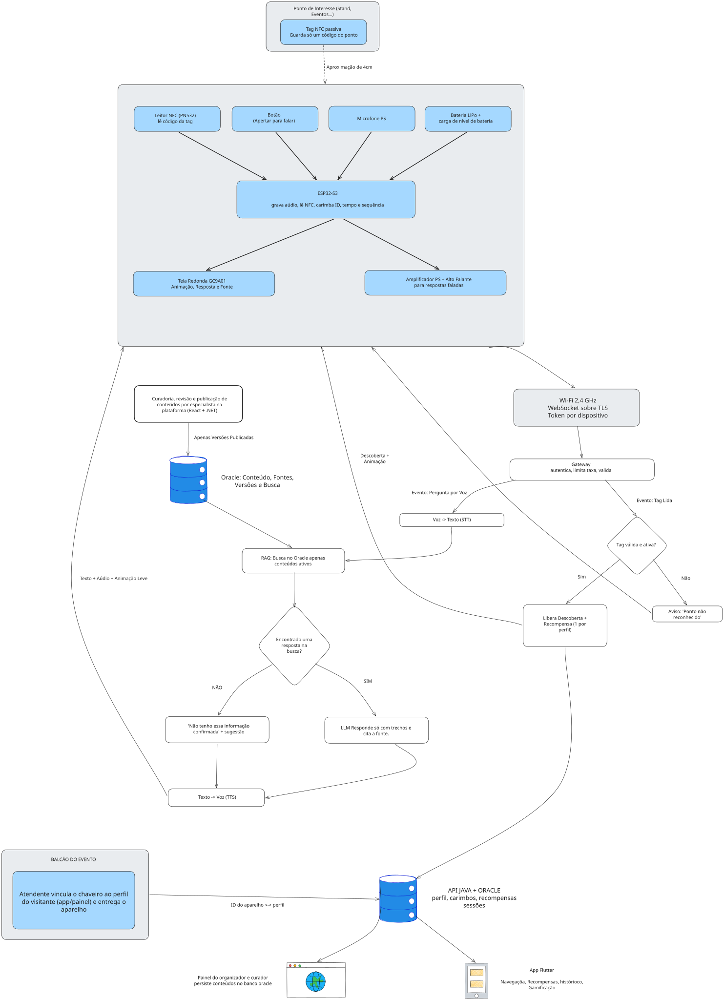

# Arquitetura da solução

Este documento explica, de forma direta, **como o Chaveiro-Passaporte funciona por dentro**: onde entram IoT e Redes, quais dispositivos existem, como eles conversam, o que acontece com os dados e que resposta o sistema devolve. Cada seção responde a um item do enunciado do Sprint 1.

> Trabalho conceitual. Nada foi construído ou medido; valores e desempenho são hipóteses a validar.

Voltar para o [README principal](../README.md).

## Índice

1. [Visão geral](#1-visão-geral)
2. [Onde IoT e Redes entram e que necessidade atendem](#2-onde-iot-e-redes-entram-e-que-necessidade-atendem)
3. [Dispositivos e componentes](#3-dispositivos-e-componentes)
4. [Comunicação](#4-comunicação)
5. [O que acontece com os dados](#5-o-que-acontece-com-os-dados)
6. [Fluxograma](#6-fluxograma)
7. [Respostas e benefícios gerados](#7-respostas-e-benefícios-gerados)
8. [Tecnologias previstas](#8-tecnologias-previstas)
9. [Segurança e privacidade](#9-segurança-e-privacidade)
10. [Falhas previstas e respostas do sistema](#10-falhas-previstas-e-respostas-do-sistema)
11. [Limitações e hipóteses a validar](#11-limitações-e-hipóteses-a-validar)

---

## 1. Visão geral

O sistema tem **três blocos**:

| Bloco | O que é | Onde fica |
|---|---|---|
| **Pontos de interesse** | Tags NFC passivas coladas em cartazes, totens e estandes. Cada uma guarda só um código. | No local do evento |
| **Chaveiro** | Dispositivo conectado (ESP32-S3) com leitor NFC, tela redonda, botão, microfone e alto-falante. | Com o visitante |
| **Servidor e aplicativos** | Gateway, voz e IA, banco Oracle, API Java, aplicativo Flutter e painel web. | Nuvem ou servidor local |

A regra de ouro: **o chaveiro captura, mostra e toca; o processamento pesado e a inteligência artificial ficam no servidor**.

## 2. Onde IoT e Redes entram e que necessidade atendem

| Necessidade do projeto | Como IoT e Redes atendem |
|---|---|
| O conteúdo fica preso ao celular, longe dos lugares reais | **Tags NFC** ligam um ponto físico ao conteúdo; o chaveiro lê a tag e entrega a descoberta no local |
| Quem tem dúvida não tem a quem perguntar | **Chaveiro conectado por Wi-Fi** envia a pergunta por voz ao servidor e recebe resposta falada |
| A internet mistura fato e desinformação | O servidor **só responde com conteúdo publicado e revisado** e mostra a fonte |
| Curadores e organizadores não sabem o que o público quer | **Dados agregados** mostram perguntas sem resposta e pontos mais visitados |

## 3. Dispositivos e componentes

### 3.1 No chaveiro

| Componente | O que mede ou executa | Onde fica instalado |
|---|---|---|
| **ESP32-S3** (DevKitC-1 N32R16V, 32 MB de flash e 16 MB de PSRAM) | Controla tela, áudio, botão e NFC; grava áudio; conecta ao Wi-Fi e ao BLE | Placa principal, dentro da carcaça |
| **Leitor NFC PN532** (ou RC522) | **Mede:** o código da tag, por aproximação | Parte de trás |
| **Microfone digital I²S** | **Mede:** a voz, somente com o botão pressionado | Furo acústico |
| **Botão** | **Mede:** toque curto e toque longo (falar e responder ao quiz) | Lateral |
| **Tela redonda GC9A01** (1,28", SPI) | **Executa:** mostra animação, resposta e fonte | Face frontal |
| **Amplificador MAX98357A + alto-falante** | **Executa:** toca a voz da resposta e os sons | Interno |
| **Bateria LiPo com carga, regulação e proteção** | Alimenta o aparelho; informa o nível de carga | Interno |
| **Carcaça impressa em 3D com argola** | Proteção e formato de chaveiro | Externa |

### 3.2 No ambiente

| Componente | Função | Onde fica |
|---|---|---|
| **Tags NFC passivas (NTAG)** | Guardam um código curto do ponto; não têm bateria nem rede | Cartazes, totens e estandes |
| **Rede Wi-Fi** (do evento ou roteador próprio) | Conecta os chaveiros ao gateway | Local do evento |
| **Balcão do evento** | O atendente vincula o chaveiro ao perfil do visitante e entrega o aparelho | Entrada do evento |

### 3.3 No servidor e nos aplicativos

| Componente | Função |
|---|---|
| **Gateway** | Autentica, limita taxa e valida os dados |
| **STT** (voz para texto) e **TTS** (texto para voz) | Transcrevem a pergunta e falam a resposta |
| **RAG sobre Oracle** | Busca a resposta só nos trechos publicados e ativos |
| **LLM** | Escreve a resposta somente com os trechos encontrados e cita a fonte |
| **API Java + Oracle** | Guardam perfis, carimbos, cards, recompensas e sessões |
| **Aplicativo Flutter** | Coleção, recompensas, histórico e vínculo do chaveiro |
| **Painel web (React + .NET)** | Curadoria de conteúdo e visão do organizador |

## 4. Comunicação

| Trecho | Meio | Por que foi escolhido |
|---|---|---|
| Tag e chaveiro | **NFC** (13,56 MHz), alguns centímetros | Interação simples, sem bateria na tag |
| Chaveiro e gateway | **Wi-Fi 2,4 GHz** com **WebSocket sobre TLS (WSS)** e **token por aparelho** | Fluxo nos dois sentidos de áudio, eventos e respostas, de forma segura |
| Configuração do Wi-Fi | **BLE** pelo aplicativo ou portal cativo no balcão | Trocar de rede sem recompilar o firmware |
| Serviços internos | **HTTPS/REST** | Padrão simples para gateway, RAG, API e curadoria |
| Sem Wi-Fi | Aviso na tela; eventos ficam em fila e sincronizam depois | Honestidade: nada é inventado |

**Alternativas consideradas**

| Alternativa | Por que não foi a principal |
|---|---|
| MQTT | Ótimo para telemetria, mas aqui o caso é áudio em fluxo |
| BLE para áudio | Taxa e alcance limitados |
| 4G/LTE | Custo, consumo e tamanho altos |
| QR code no lugar de NFC | Funciona, mas exige câmera e é menos imediato que encostar |

## 5. O que acontece com os dados

| Dado | Origem | Para onde vai | Como é processado | Quem usa |
|---|---|---|---|---|
| Código da tag NFC | Leitor NFC | Gateway, depois API Java | Valida se a tag existe e está ativa; libera 1 carimbo por perfil e ponto | Visitante (card e recompensa) |
| Voz da pergunta | Microfone (só com o botão pressionado) | Gateway, depois STT | Vira texto; o áudio é descartado após a transcrição, salvo consentimento | RAG e LLM |
| Pergunta em texto | STT | RAG sobre Oracle | Busca em trechos publicados e ativos; se não houver suporte, resposta fixa | LLM, curador (perguntas sem resposta) |
| Resposta | LLM | TTS, depois chaveiro | Texto, áudio e animação voltam ao aparelho | Visitante |
| Eventos de botão | Botão | Gateway | Inicia e encerra a fala; registra a resposta do quiz | API Java |
| ID do aparelho, tempo e sequência | Firmware | Gateway | Autentica, ordena e evita duplicidade | Gateway |
| Nível de bateria e qualidade do Wi-Fi | Circuito de carga e rádio | Tela do chaveiro | Mostra aviso de carga baixa ou "sem conexão" | Visitante |
| Perfil, carimbos, cards e recompensas | API Java | Oracle | Registro relacional | Aplicativo Flutter |
| Visitas por ponto e perguntas sem resposta | Oracle | Painel web | Dados **agregados e anônimos** | Organizador e curador |

## 6. Fluxograma

O desenho completo, feito pelo grupo, está em [`design-system/design-system-chaveiro-passaporte.svg`](../design-system/design-system-chaveiro-passaporte.svg) e no [Excalidraw](https://excalidraw.com/#json=2TulqWKhCVXWzyDQ_-Kv0,DDHy8RHHJvTlpH9j04l5Hw).

  

## 7. Respostas e benefícios gerados

| Tipo de resposta | O que o sistema faz |
|---|---|
| **Responder dúvidas** | Fala a resposta com base no conteúdo revisado e mostra a fonte |
| **Acionar dispositivo** | Tela com animação, voz no alto-falante e sons |
| **Atualizar o aplicativo** | Novo card colecionável, recompensas e histórico |
| **Emitir alerta** | Sem conexão, bateria baixa, ponto não reconhecido |
| **Apoiar decisão** | O curador vê o que a base ainda não cobre; o organizador vê quais pontos atraem mais gente |

Somente respostas a perguntas de compreensão pontuam. Tempo conectado, sozinho, não comprova aprendizagem. Os cards são registros no banco de dados, sem blockchain.

## 8. Tecnologias previstas

| Camada | Tecnologia |
|---|---|
| Firmware | ESP32-S3, referência no Muse Gadgets SDK (Apache 2.0), interface LVGL |
| Rede | NFC 13,56 MHz, Wi-Fi 2,4 GHz, WebSocket sobre TLS, BLE, HTTPS/REST |
| Backend | Gateway próprio, STT, TTS, LLM, API Java |
| Dados | Oracle (modelo relacional, terceira forma normal, RAG sobre o próprio banco) |
| Aplicativos | Flutter (visitante) e painel web React + .NET (curador e organizador) |

O modelo de dados prevê as tabelas conceituais perfil, dispositivo, vínculo, ponto de interesse, descoberta, carimbo, card, trecho, fonte, sessão, turno e progresso de missão. A escolha entre busca vetorial do Oracle 23ai (se a versão permitir), Oracle Text ou embeddings em tabela fica para a implementação.

## 9. Segurança e privacidade

- **TLS** em toda a conexão do chaveiro com o gateway.
- **Token por aparelho**, revogável e sem credenciais fixas no código (emitido no vínculo).
- **Limite de taxa** e duração máxima de áudio.
- Rede do chaveiro **isolada** de qualquer rede operacional.
- **Push-to-talk garantido pelo firmware**: o microfone só capta com o botão pressionado.
- **LGPD:** consentimento no vínculo, áudio descartado após a transcrição (salvo consentimento), o usuário pode apagar perfil, recompensas e histórico, e o piloto inicial é com adultos.
- **Limite honesto da tag NFC:** o código pode ser copiado. O carimbo é um recurso de experiência, não prova segura de presença; o servidor valida se a tag existe e está ativa e limita a um carimbo por perfil e ponto.

## 10. Falhas previstas e respostas do sistema

| Falha | Resposta do sistema |
|---|---|
| Tag desconhecida ou inativa | Mensagem "ponto não reconhecido" |
| Mesma tag lida de novo | Mostra a descoberta; não duplica o carimbo |
| Sem Wi-Fi | Aviso na tela; guarda eventos em fila; nada é inventado |
| Atraso ou áudio ruim | Animação de espera, limite de tempo e pedido para repetir |
| Pergunta fora da base | "Não tenho essa informação confirmada" e sugestão de descoberta relacionada |
| Bateria baixa | Aviso antes de iniciar a resposta; perguntas bloqueadas em carga crítica |

## 11. Limitações e hipóteses a validar

- O aprendizado em si ocorre no aplicativo; o ganho de compreensão pelo chaveiro é hipótese.
- As camadas 2 e 3 exigem Wi-Fi no local e alguém para instalar as tags e operar o balcão.
- A qualidade depende de STT e TTS em português e do ruído do ambiente.
- A revisão humana do conteúdo continua necessária.
- Latência, custo de nuvem por pergunta, autonomia da bateria, acústica e mapa de pinos dependem de protótipo.
- A PSRAM octal do módulo N32R16V ocupa alguns pinos, e tela, NFC, microfone e amplificador dividem barramentos: o mapa de pinos precisa ser confirmado.
- Com tela, leitor NFC, microfone e amplificador, o protótipo pode ficar maior que um chaveiro de bolso.
